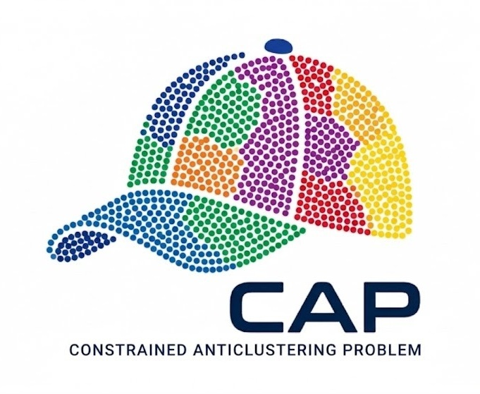

# CAP: Constrained Anticlustering Problem </br>

<p align="center">
  
</p>

This repository contains the **source code, benchmark datasets, pairwise constraint sets, and reference label files** used in the paper:

> A. L. Croella, V. Piccialli, and A. M. Sudoso, *Decomposing Clustering Problems with Must-Link and Cannot-Link Constraints to Compute Strong Bounds*,
> manuscript under review.

---

## 🧩 Overview

CAP computes valid lower bounds for minimum sum-of-squares clustering with
pairwise constraints. It partitions a constrained instance into
constraint-preserving anticlusters with a variable neighborhood search (VNS),
then solves the induced subproblems with PC-SOS-SDP and sums their lower
bounds. Every connected component of the pairwise-constraint graph is kept
within one anticluster.

The repository provides everything required to reproduce the experiments reported in the paper.

```text
.
├── anticlustering_c++/    CAP--VNS and lower-bound implementation
├── clustering_matlab/     MATLAB routines called by PC-SOS-SDP
├── data/
│   ├── datasets/          synthetic and real benchmark datasets
│   ├── constraints/       generated cannot-link constraint sets
│   ├── labels/            feasible reference clusterings
│   ├── plots/             diagnostic plots for the generated instances
│   ├── pccc/              instance generator and PCCC implementation
│   ├── example_LOG.txt    log file for a synthetic instance
│   └── README.md          data formats, sources, and generation procedure
└── figures/               repository figures and logo
```

The benchmark instances include both synthetic datasets and real-world datasets (see [`data/README.md`](data/README.md) for the benchmark description and
input-file conventions).

<br>

## 🛠️ Installation

CAP calls [PC-SOS-SDP](https://github.com/antoniosudoso/pc-sos-sdp), an exact
branch-and-bound solver for pairwise-constrained MSSC. PC-SOS-SDP uses
[SDPNAL+](https://blog.nus.edu.sg/mattohkc/softwares/sdpnalplus/) through the
[MATLAB Engine API for C++](https://www.mathworks.com/help/matlab/calling-matlab-engine-from-cpp-programs.html).
The C++ implementation additionally requires [Gurobi](https://www.gurobi.com/),
[Armadillo](https://arma.sourceforge.net/), BLAS/LAPACK, and POSIX threads.
The MATLAB routines included in `clustering_matlab/` are distributed under
the GPL-3.0 license of PC-SOS-SDP; see their local
[`README`](clustering_matlab/README.md) and [`LICENSE`](clustering_matlab/LICENSE).

### Ubuntu / Debian instructions

1. Install MATLAB and Gurobi.
2. Install the system dependencies:

   ```bash
   sudo apt-get update
   sudo apt-get install make g++ libopenblas-dev liblapack-dev libarmadillo-dev
   ```

3. Download SDPNAL+ and copy `clustering_matlab/` into the SDPNAL+ root
   directory. The MATLAB engine adds the directory specified by
   `SDP_SOLVER_FOLDER` and all its subdirectories to the MATLAB path.
4. Open [`anticlustering_c++/Makefile`](anticlustering_c++/Makefile) and set
   `MATLAB_DIR`, `GUROBI_DIR`, and, when needed, `GUROBI_LIB`. For example:

   ```bash
   cd anticlustering_c++
   make MATLAB_DIR=/opt/MATLAB/R2024b \
        GUROBI_DIR=/opt/gurobi1200/linux64 GUROBI_LIB=gurobi120
   ```

5. In [`anticlustering_c++/config.txt`](anticlustering_c++/config.txt), set
   `SDP_SOLVER_FOLDER` to the SDPNAL+ root directory containing
   `clustering_matlab/`.
6. To generate new feasible instances, install Python 3.10 or later and
   the libraries used by [`PCCC`](https://github.com/phil85/PCCC-Algorithm).
   Further details are in [`data/README.md`](data/README.md).

<br>

## ⚙️ Configuration

The CAP parameters are set in [`anticlustering_c++/config.txt`](anticlustering_c++/config.txt).
The released configuration and settings are reported in the paper.

<br>

## ▶️ Usage

Compile and run CAP from `anticlustering_c++/`:

```bash
cd anticlustering_c++
./cap ../data/datasets/syn-1500-50.txt \
      ../data/constraints/syn-1500-50_300_20_1_cl.txt \
      ../data/labels/syn-1500-50_300_20_1.txt 15
```

The input arguments are:

- `DATASET`: path to a data file with header `N D K`;
- `CONSTRAINTS`: path to a CL/ML constraint file;
- `LABELS`: path to a feasible reference clustering, with one zero-based label
  per observation;
- `T_OR_AUTO` (optional): a positive number of anticlusters or `auto`;
- `AUTO_T_PROFILE` (optional): `min`, `mid`, or `max` when `T_OR_AUTO=auto`.

The program constructs the anticlustering partition with VNS. Its logs and results are written to `results/`.

<br>

## 📑 Log output

The log records the instance and constraint-graph statistics, the selected
number of anticlusters, the VNS starts and CAP objective values, and the
lower-bound information returned for each induced PC-SOS-SDP subproblem. The
summary row reports the VNS and lower-bound times, the number of points and CL
pairs represented in each anticluster, and the resulting bound gap.

👉 See the [`example`](data/example_LOG.txt) for details.

<br>

## 📚 Related works

> A. L. Croella, V. Piccialli, and A. M. Sudoso, *Strong bounds for large-scale Minimum Sum-of-Squares Clustering*,
> **European Journal of Operational Research** (2027).
> [Paper](https://doi.org/10.1016/j.ejor.2026.07.045)
> [Code](https://github.com/AnnaLivia/AVOC)

> V. Piccialli, A. Russo, and A. M. Sudoso, *An Exact Algorithm for Semi-supervised Minimum Sum-of-Squares Clustering*,
> **Computers & Operations Research** (2022).
> [Paper](https://doi.org/10.1016/j.cor.2022.105958)
> [Code](https://github.com/antoniosudoso/pc-sos-sdp)


<br>

## ✍️ How to cite

If you use CAP or the distributed benchmark instances, please cite:

```bibtex
@misc{croella2026cap,
  author = {Anna Livia Croella and Veronica Piccialli and Antonio M. Sudoso},
  title = {Decomposing Clustering Problems with Must-Link and Cannot-Link
           Constraints to Compute Strong Bounds},
  year = {2026},
  note = {Manuscript under review}
}
```

<br>
